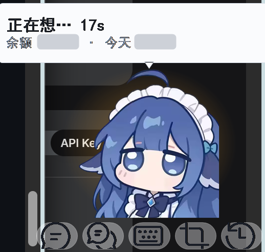

<div align="center">
  <a href="https://github.com/Jasolicon/dsh-desktop-pet-assistant-bloop" target="_blank">
    
  </a>
  <h1>泡泡 · Bloop</h1>
  <p>基于 DeepSeek Harness 的 Windows 桌面常驻助手</p>
</div>

<p align="center">
  <a href="LICENSE"></a>
  
  
  
</p>

> [!TIP]
> 泡泡大多数时候什么都不说。沉默和开口一样，都是本地判断的结果；每次判断、每条沉默理由、每次任务执行都会留在本机日志里。

## 目录

- [这是什么](#这是什么)
- [它如何调用 DSH](#它如何调用-dsh)
- [功能](#功能)
- [快速开始](#快速开始)
- [设置](#设置)
- [安装包与发布](#安装包与发布)
- [Agent 事件协议](#agent-事件协议)
- [隐私与安全](#隐私与安全)
- [开发与测试](#开发与测试)
- [项目结构](#项目结构)
- [已知限制](#已知限制)
- [许可与致谢](#许可与致谢)

## 这是什么

泡泡是一个把 DeepSeek Harness（DSH）的 agent 能力带到桌面上的 Windows 助手。

它同时承担两件事：

- **桌面陪伴**：透明置顶的小鲸鱼，会待机、点击回应、拖拽、吃饭、过节、在深夜打哈欠，也会在合适的时候说一句。
- **主动协助**：在后台按任务节奏观察屏幕；需要用户注意时提醒，需要做事时把任务交给 DSH agent 执行。

它不要求用户先打开聊天窗口，也不要求用户先意识到自己卡住了。做菜、修理、开会、赶表格时，用户的手和注意力都可能被占着；泡泡在后台看，值得说才开口，不值得就保持安静。

## 它如何调用 DSH

DSH 是泡泡的大脑。泡泡本身负责桌面窗口、屏幕采样、本地闸门、气泡、语音和交互；判断、对话、工具调用、权限审批和子 agent 由 DSH 负责。

```text
Desktop pet (Electron)
  │
  ├─ judge session ── stdio JSON-RPC ──> dsh --profile sdk
  │     只读、工具精简，负责“要不要说”
  │
  ├─ work session  ── stdio JSON-RPC ──> dsh --profile sdk
  │     有工具与权限，负责“去做”
  │
  ├─ chat window   ── local web ───────> dsh --profile web
  │     Markdown / 工具卡片 / 会话侧栏
  │
  └─ approval & question bridge ───────> pet-responder
        气泡上的允许 / 拒绝 / 选项，写回 DSH
```

### 常驻会话

`src/dsh-session.mjs` 通过 `dsh --profile sdk` 起一条常驻的 stdio JSON-RPC 会话。一次初始化之后，每轮判断或派活不需要重新启动 DSH。

两条会话分工明确：

| 会话 | 用途 | 权限与工具 |
| --- | --- | --- |
| `judge` | 看屏幕、判断“现在值不值得开口” | 只读；按行关闭用不到的工具，降低每轮 token 与延迟 |
| `work` | 执行用户派出的任务、读取文件、调用工具 | 工作 agent 的权限档；可开子 agent |

模型和权限通过 `agents.json` 与 `--patch` 注入。默认使用本机 DSH 已登录的 `deepseek-account` 路由，不需要另配 API key；也可以在设置里切换模型或权限档。

### 一次性回退

常驻会话起不来、或某条会话被服务端拒绝时，`src/brain.mjs` 会退回 `dsh --profile headless --json` 的一次性调用。速度慢一些，但不会因为一条会话坏掉就整个哑掉。

### 对话窗口

`src/webui.mjs` 启动 `dsh --profile web --port <端口> --no-open`，用 DSH 自己的 Web 界面承载 Markdown、工具卡片、流式输出和会话侧栏。泡泡只负责窗口和生命周期，不重画聊天界面。

### 审批与提问

`desktop-guide/pet-responder` 是 DSH 侧的小插件：它监听审批与提问的 waterfall，把请求写成 `run/ask` 下的文件；泡泡的气泡显示“允许 / 拒绝 / 稍后”或模型给出的选项，用户点选后再写回应答文件。

### 子 agent 与记忆

- 子 agent：`src/subagents.mjs` 从工作会话的事件流里识别 `agent-start` / `agent-end`，在气泡里显示后台子任务进度。
- 记忆：`src/memory.mjs` 把观察日志压成一段活动汇总，接进判断提示词；压缩不调用模型。
- 账本：`src/ledger.mjs` 记录余额、充值、每次调用花费和每日消费上限；到线自动暂停自动观察。

## 功能

### 主动观察

后台按任务档采样屏幕。每次采样先算一张 160×90 的指纹；本地闸门根据画面变化、前台窗口、距上次判断的时间、用户闲置和待机状态决定要不要起一次模型调用。

放行之后，截图会随消息内联给模型，模型只输出一句值得说的话；没有值得说的就输出 `SILENT`。判断记录和沉默理由写入 `logs/`，可以在“看它判过什么”里查看。

任务档可以按进程名或窗口标题匹配，例如卡牌游戏提高采样率、视频播放降低打扰频率。监控区域支持只截取屏幕的一部分。

观察链路现在分两段：

- **常驻桌面流**：启动时建立一次 `getUserMedia` 屏幕流，之后每次采样只做 `drawImage` + `getImageData`；本机实测小图采样从约 0.5–1.1 秒降到 20–55 毫秒，按需高清 JPEG 约 40–65 毫秒。
- **本地预测**：根据窗口切换、画面突发变化、持续小幅编辑、长时间静止和后台 Agent 状态，生成 `context_switch` / `screen_burst` / `steady_edit` / `still_or_stuck` / `agent_working` 等先验。窗口切换和明显突变走快速通道，不再等满常规 60 秒；预测会写进判断提示词，但明确标注“不是事实”，由当前截图核验。
- **自适应节奏**：用户刚有键鼠输入时默认 1 秒采样，停手后回到 2 秒；采样器本身已由常驻流降到毫秒级。
- **排除自体反馈**：泡泡自己的透明窗口和气泡不会被当成“用户前台窗口”，避免“气泡出现 → 画面变化 → 再判断 → 再冒泡”的自激循环。

### 任务执行

- 长按桌宠说话，松开后由 SenseVoice 在本机离线识别，再交给 DSH 工作 agent。
- `Ctrl+Alt+T` 或底部按钮打开“打字派活”。
- 把文件或图片拖到桌宠身上，按 DSH 原生文件引用交给 agent。

任务完成后，泡泡把最后一行结论显示在气泡里并朗读；失败也会如实回报。每次派活默认新建一条 agent 会话，也可以在“子 agent 管理”里选择持续复用同一条会话。

### 对话

右键“对话”打开 DSH 的 Web 界面。支持 Markdown、代码块、工具卡片、流式输出、会话侧栏和审批。

### 语音

- 语音输入：SenseVoice + sherpa-onnx，本机离线识别；首次使用时按需下载约 229MB 模型。
- 语音输出：默认走微软 Edge 神经音色；断网时可以切换到本机系统音色。
- 朗读支持队列、去重、丢弃最旧和打断；单击正在朗读的桌宠即可让它闭嘴。

### 生活节奏与动作

生活节奏是本地时钟层，不调用模型、不截图。它负责：

- 时间段：清晨、上午、午间、下午、晚上、深夜，支持跨午夜。
- 饭点：早餐、午餐、晚餐；进入饭点时优先播放对应动作。
- 节日：公历与农历节日，支持节日前后的气氛窗口。
- 动作：待机、点击、拖拽、思考、说话、开场、自动事件；每条规则可配置素材、权重与冷却。
- 提醒：每天、工作日、周末或指定星期；支持提前提醒、到点提醒、宽限补发和系统通知。
- 日志：时段、饭点、节日、动作、提醒和错过提醒写入 `logs/rhythm.jsonl`。

动作素材默认放在 `desktop-pet/assets/actions/`，按 `idle`、`click`、`drag`、`thinking`、`speaking`、`greeting`、`event`、`meal`、`holiday` 分类。新增素材后在设置表格里点“刷新素材”即可，不需要重启桌宠。

### 判断记录与账本

“看它判过什么”会显示判断次数、说了几次、沉默几次和每次沉默的理由。账本显示余额、上次调用花费、今天花费和每日上限；到上限后自动暂停自动观察。

## 快速开始

### 环境要求

| 需要 | 说明 |
| --- | --- |
| Windows 10/11 x64 | 当前桌面实现只支持 Windows |
| Node.js 18+ | 运行 Electron 与构建脚本 |
| DeepSeek Harness | 必须安装并登录；泡泡默认复用 DSH 的账号路由 |
| PowerShell 7（可选） | 只有运行 `desktop-guide/` 参考实现或旧版自检时需要 |

语音输入和朗读是可选能力；不装模型时，文字气泡和任务执行仍然可用。

### 运行

```powershell
git clone https://github.com/Jasolicon/dsh-desktop-pet-assistant-bloop.git
cd dsh-desktop-pet-assistant-bloop\desktop-pet
npm install
npm start
```

也可以双击 `desktop-pet\start.cmd`。首次启动会探测 DSH 安装位置，并把结果写回 `config.json`。

### 自检

```powershell
cd desktop-pet
npm test
```

只开窗口、不启动观察循环：

```powershell
$env:PET_NO_AUTO = '1'
npm start
```

开发用的渲染快照：

```powershell
$env:PET_DEBUG_CAPTURE = "$PWD\run\pet.png"
npm start
```

## 设置

右键桌宠 →“设置”，所有可调项都在一个窗口里。修改后点保存；标了“立即生效”的项会当场生效。

| 分组 | 主要设置 |
| --- | --- |
| 外观 | 角色图、窗口宽度、字体、字号、气泡停留、状态光晕 |
| 说话风格 | `guard` 保守 / `coach` 陪练 / `roast` 损友 / `scout` 找事 |
| 模型与权限 | 主 agent 模型、工作 agent 权限 |
| 采集与节奏 | 监控区域、采样间隔、任务规则、截图宽度与质量、待机探测 |
| 生活节奏与动作 | 时间段、饭点、节日、提醒、动作规则、素材目录、动作缩放 |
| 判断与闸门 | 判断间隔、画面差异阈值、沉默退避、长期记忆、脱敏 Agent 事件 |
| 账本 | API key、余额轮询、充值阈值、每日消费上限 |
| 语音输入 / 朗读 | 长按判定、麦克风、音色、语速、队列 |
| 路径 | DSH 安装根、`cli.js`、`node.exe` 等 |

常用配置键：

| 键 | 默认 | 说明 |
| --- | --- | --- |
| `speakStyle` | `coach` | 说话风格 |
| `sampleSeconds` | `2` | 采样间隔 |
| `judgeMinSeconds` | `60` | 两次自动判断的最小间隔 |
| `judgeMinFpDelta` | `12` | 画面指纹差异阈值 |
| `dailySpendCapYuan` | `50` | 每日消费上限；`0` = 不设 |
| `rhythmEnabled` | `true` | 启用时间段/饭点/节日 |
| `actionEnabled` | `true` | 启用动作库 |
| `reminderLeadMinutes` | `5` | 默认提前提醒 |
| `rhythmGraceMinutes` | `10` | 错过提醒的补发窗口 |
| `agentEventsEnabled` | `true` | 写脱敏 Agent 事件 |

## 安装包与发布

### 目录形态（onedir）

```powershell
cd desktop-pet
npm run pack
```

产物在 `dist/win-unpacked/`：运行时零解压，直接双击 `随时指导桌宠.exe` 即可。这是最适合本地验证和便携分发的形态。

### 安装包与便携版

```powershell
npm run dist
```

产物：

- NSIS 安装包：当前用户安装，不需要管理员权限，可选安装目录。
- 便携版 exe：单个可执行文件，适合不想安装的场景。

### 发行清单

```powershell
npm run release:manifest
```

生成 `dist/update.json`，记录版本、下载地址、文件大小和 SHA-256。发布时把安装包、便携版和 `update.json` 一起上传到 GitHub Release。

`assets/actions` 通过 `asarUnpack` 放在 `app.asar.unpacked/assets/actions`，透明 WebM 用真实文件路径播放，不从归档里流式解码。

## Agent 事件协议

泡泡把 DSH 的生命周期写成脱敏 JSONL，默认路径：

```text
logs/agent-events/dsh.jsonl
```

每行只包含元数据：

```json
{"ts":1792200000.12,"agent":"dsh","event":"tool/call","state":"working","tool":"read","sessionId":"..."}
{"ts":1792200001.40,"agent":"dsh","event":"turn/end","state":"idle","sessionId":"..."}
```

状态只有六种：`thinking`、`working`、`attention`、`error`、`idle`、`sleeping`。

**不会写入**：用户消息正文、模型回复正文、工具参数、工具结果、截图或文件路径。

事件文件超过 1MB 时轮转为 `.1`，读方可以按 byte-offset 增量读取，不需要回放历史。外部 Agent 可以按同一格式追加写；当前桌面端先消费 DSH 会话事件，接入其它 Agent 时需要增加一个 tail 适配层。

## 隐私与安全

- 不监听键盘输入，不读剪贴板，不记录窗口内的文字。
- 截图只保留在内存环形缓冲里；落盘的只有窗口标题、进程名、时间和判断记录。
- 截图会随请求交给 DSH 当前配置的模型服务；具体隐私边界取决于所使用的模型供应商。
- Agent 事件只写元数据，不写正文、命令参数和截图路径。
- API key 存在本机 `run/deepseek.key` 或环境变量中，不写入日志。
- 默认每日消费上限 50 元，到线自动暂停自动观察。
- 安装包当前没有代码签名，Windows SmartScreen 可能提示需要手动放行。

## 开发与测试

```powershell
cd desktop-pet
npm test
```

测试覆盖本地闸门、指纹、DSH 会话、审批桥、账本、记忆、子 agent、语音、动作节奏、提醒和 Agent 事件脱敏。

常用调试环境变量：

| 变量 | 作用 |
| --- | --- |
| `PET_NO_AUTO=1` | 只起窗口，不启动屏幕观察 |
| `PET_NO_LOCK=1` | 跳过单实例锁 |
| `PET_DEBUG_CAPTURE=<png>` | 渲染一张页面快照后退出 |
| `PET_DEBUG_SETTINGS=<png>` | 打开设置窗口并截图 |
| `PET_DEBUG_ACTION=<id>` | 启动后试播一个动作 |

## 项目结构

```text
desktop-pet/                 Electron 桌面实现（当前主实现）
  src/
    main.mjs                 主进程：窗口、托盘、IPC、生命周期
    dsh-session.mjs          DSH 常驻会话（sdk profile）
    brain.mjs                DSH 一次性回退（headless profile）
    webui.mjs                DSH Web 对话窗口
    monitor.mjs              屏幕采样与本地闸门
    rhythm.mjs               时间段/饭点/节日/提醒纯逻辑
    rhythm-runtime.mjs       动作调度、提醒、节奏日志
    agent-events.mjs         脱敏 Agent 事件协议
    settings/                设置窗口与 schema
    renderer/                桌宠窗口与动作播放
  assets/actions/            分类动作素材
  test/                      Node 测试

desktop-guide/               行为参考实现与 DSH 应答器插件
behavior-cases/              行为用例表
docs/                        截图与说明
```

## 已知限制

- 当前桌面实现只支持 Windows。
- 多显示器只抓主屏；全屏独占程序可能抓不到。
- 语音识别是整句的，不支持边说边出字。
- DSH 必须安装并登录；没有 DSH 时，任务、对话和判断都不可用。
- Electron 固定为 28：本机 Electron 33 启动会崩溃，28 已稳定运行。
- 打包版 exe 在本机启动返回 `0x80000003`，尚在排查；源码运行与 `win-unpacked` 资源已通过验证，发布前必须解决这个问题。
- 动作素材来自社区角色素材链，仅限个人非商业使用；泡泡自身也是非商业许可项目，商用需要替换素材。

## 许可与致谢

泡泡的代码、提示词、文档和自绘素材以 **PolyForm Noncommercial License 1.0.0** 发布：
个人研究、学习、娱乐和非商业项目可以自由使用；商业使用需要另行授权。

角色图与动作素材不在上述许可范围内，来源与限制见
[`desktop-pet/assets/actions/ATTRIBUTION.md`](desktop-pet/assets/actions/ATTRIBUTION.md)
与 [`THIRD_PARTY_NOTICES.md`](THIRD_PARTY_NOTICES.md)。

感谢：

- **DeepSeek Harness**：判断、对话、工具调用、审批与子 agent 的运行时。
- **sherpa-onnx / SenseVoice**：本机离线语音识别。
- **Microsoft Edge 神经音色**：默认语音朗读。
- **PC2005-cloud/dsh-pet** 与社区角色素材作者：透明 WebM 动作素材。

---

<div align="center">
  <sub>Made with 🐳 &amp; ⌨️ · 泡泡 · Bloop</sub>
</div>
